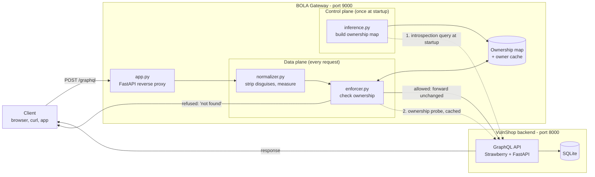
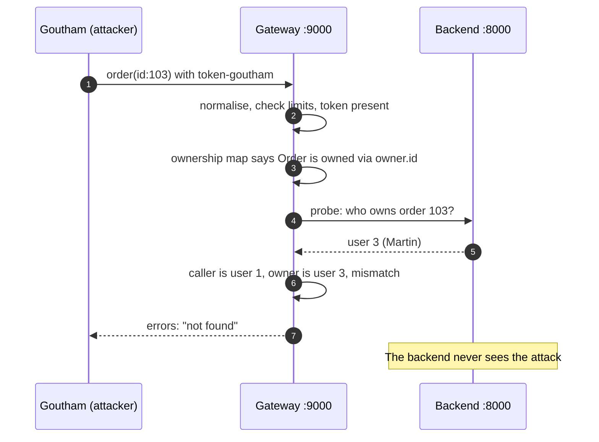
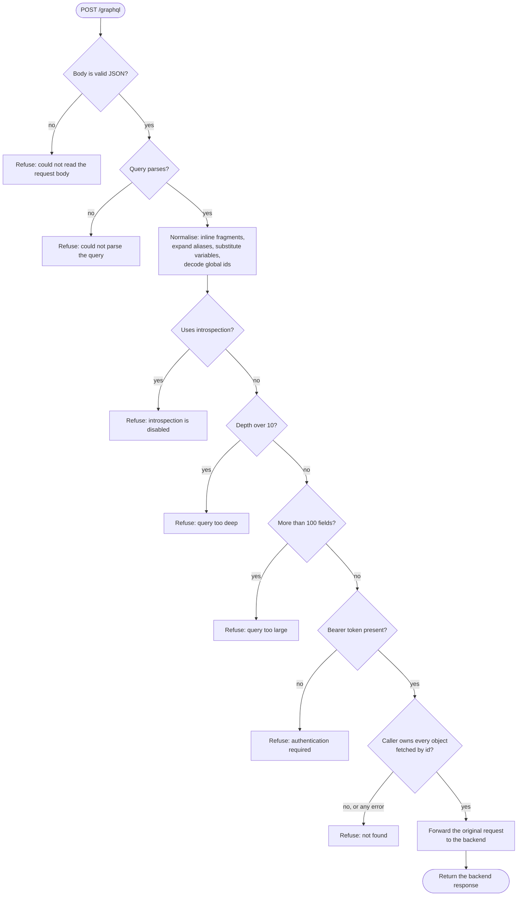

# GraphQL BOLA Gateway

> A reverse-proxy security gateway that stops **BOLA** (Broken Object Level Authorization) in GraphQL APIs, **without changing the backend**.


The gateway reads a GraphQL backend's schema, works out on its own which user owns each kind of object, and then checks ownership on every request. If a logged-in user asks for an object that belongs to someone else, the request is refused before it reaches the backend.

This repository holds two programs: the **gateway**, and **VulnShop**, a deliberately vulnerable GraphQL shop to attack and protect. It was built as a final-year cybersecurity project.

> **This is a research prototype, not a production security control.** It has open bypasses. Read [Known issues](#known-issues) before relying on it.

---

## Table of contents

1. [The problem](#the-problem)
2. [What the gateway does](#what-the-gateway-does)
3. [Architecture](#architecture)
4. [How a request is processed](#how-a-request-is-processed)
5. [How ownership is inferred](#how-ownership-is-inferred)
6. [Repository layout](#repository-layout)
7. [Tech stack](#tech-stack)
8. [Getting started](#getting-started)
9. [Using it](#using-it)
10. [Verify it works](#verify-it-works)
11. [Configuration](#configuration)
12. [What is covered](#what-is-covered)
13. [Implemented and planned](#implemented-and-planned)
14. [Known issues](#known-issues)
15. [Troubleshooting](#troubleshooting)
16. [Documentation](#documentation)
17. [Contributing](#contributing)
18. [Legal and ethics](#legal-and-ethics)
19. [License](#license)

---

## The problem

GraphQL APIs put every query through one endpoint, `/graphql`. The server always knows *who* is calling, but nothing makes it check *whether that caller owns the object they asked for*. That check must be written by hand in every resolver, and one missed check is a vulnerability.

The attack is trivial. A user changes one number:

```graphql
{ order(id: 124) { total shippingAddress } }   # my order
{ order(id: 125) { total shippingAddress } }   # a stranger's order, and the server returns it
```

That is **BOLA**, ranked #1 in the OWASP API Security Top 10. In GraphQL it is worse than in REST, because one request can ask for hundreds of objects through aliases, hide the ids in variables, split the query across fragments, or wrap ids in base64. Ordinary firewalls cannot parse any of that.

Fixing every resolver by hand does not scale. Existing gateways enforce roles and scopes ("is this user an admin?"), not per-object ownership ("does this user own order 125?"). Background: [docs/graphql-and-bola.md](docs/graphql-and-bola.md).

## What the gateway does

- **Infers ownership rules from the schema.** No hand-written policy. At startup it finds the identity type (`User`) and which types hang off it (`Order` is owned through `owner.id`).
- **Normalises every query before judging it.** Aliases, fragments, variables and encoded ids are resolved first, so a disguised attack looks the same as a plain one.
- **Checks the real owner at runtime.** For every object fetched by id it asks the backend who owns it and compares that with the caller. Answers are cached for 30 seconds.
- **Fails closed on unclear types.** A type it cannot classify goes into an `UNRESOLVED` bucket and is blocked until a human reviews it.
- **Refuses uniformly.** Every refusal says `"not found"`, so an attacker cannot tell a missing object from a forbidden one.
- **Needs no backend change.** It is a proxy. The backend can be written in any language.

## Architecture

The gateway sits between clients and the backend. It has two halves. The **control plane** runs once at startup and builds the ownership map. The **data plane** runs on every request and uses that map.



**Dashed lines** are the gateway's own questions to the backend (the schema at startup, the ownership probe at runtime). **Solid lines** are client traffic.

| Component | File | Role |
|---|---|---|
| Proxy | `gateway/app.py` | Receives requests, runs the checks in order, forwards or refuses. |
| Control plane | `gateway/inference.py` | Fetches the schema once and builds the ownership map. |
| Normaliser | `gateway/normalizer.py` | Parses the query to a tree and removes disguises. Measures depth and size, and spots introspection. |
| Enforcer | `gateway/enforcer.py` | Walks the normalised query and verifies the caller owns each object fetched by id. |
| Settings | `gateway/config.py` | Backend URL, port, limits, ownership words, cache lifetime. |
| Backend | `vulnshop/` | The deliberately vulnerable shop that the gateway protects. |

### Why the attack fails



## How a request is processed

Every request to `POST /graphql` goes through this pipeline in `gateway/app.py`. The cheap checks come first, so work is rejected as early as possible.



The ordering matters. Ownership is checked **only after** the query has been normalised, because checking a query you cannot see clearly is how disguised attacks get through. Any exception inside the ownership step also ends in `"not found"`.

## How ownership is inferred

At startup `inference.py` sends an introspection query to the backend and classifies every type into one of four tiers.

| Tier | Meaning | Example | Gateway behaviour |
|---|---|---|---|
| `IDENTITY` | The type that represents the logged-in user, found through a root field named `me`, `viewer` or `currentUser` | `User` | Checked directly against the caller |
| `OWNED` | Linked to the identity type through an ownership field | `Order -> owner -> id` | Owner looked up and compared with the caller |
| `PUBLIC` | Nothing in it points to an owner | `Product` | Allowed |
| `UNRESOLVED` | Could not be classified with confidence | an oddly named type | **Blocked** until reviewed |

The words that signal ownership are a keyword list in `gateway/config.py` (`owner`, `author`, `creator`, `user`, `customer`, `createdby`, `account`, `assignee`, `seller`). This is a **heuristic**. It works on conventional schemas, and an unusual one lands in `UNRESOLVED`. You can add words to the list. Blocking by default is intentional.

For the output of this step on VulnShop:

```
Ownership map (built from the schema):
  identity type: User
   - User -> IDENTITY
   - Order -> OWNED ['owner', 'id']
   - Product -> PUBLIC
```

Full walkthrough with worked traces: [docs/gateway-logic.md](docs/gateway-logic.md).

## Repository layout

```
graphql-bola-gateway/
├── README.md
├── LICENSE
├── .gitignore
├── gateway/                 the BOLA gateway
│   ├── app.py               reverse proxy, ordering of checks      (port 9000)
│   ├── inference.py         control plane: schema -> ownership map
│   ├── normalizer.py        strips disguises, measures the query
│   ├── enforcer.py          data plane: ownership checks
│   ├── config.py            settings
│   ├── requirements.txt
│   └── README.md
├── vulnshop/                deliberately vulnerable backend
│   ├── app.py               Strawberry + FastAPI GraphQL server    (port 8000)
│   ├── database.py          creates and seeds the SQLite database
│   ├── static/
│   │   ├── index.html       small web UI: sign in, view and look up orders
│   │   └── playground.html  GraphQL console with a user dropdown (opens at `/static/playground.html`)
│   ├── requirements.txt
│   └── README.md
├── docs/
│   ├── graphql-and-bola.md  background: GraphQL, BOLA, why it is unsolved
│   ├── design.md            target architecture, status, what is new
│   ├── gateway-logic.md     file-by-file code walkthrough
│   ├── literature-survey.md related research and tools
│   ├── running.md           detailed run guide and troubleshooting
│   └── roadmap.md           planned work and out-of-scope items
└── scripts/
    └── demo.ps1             runs every attack against both ports (PowerShell)
```

## Tech stack

| Layer | Technology |
|---|---|
| Gateway proxy | Python, FastAPI, Uvicorn |
| Query parsing | graphql-core |
| Backend calls | httpx |
| Vulnerable backend | Python, Strawberry GraphQL, FastAPI, Uvicorn |
| Storage | SQLite (file created on first run) |
| Cache | In-memory dictionary (Redis is a planned replacement) |

No build step. No Docker needed.

## Getting started

### Prerequisites

- **Python 3.10 or newer.** Tested on Python 3.12.
- `pip`
- Two terminal windows
- `curl` for the examples below (browser use needs nothing else)

### Install and run

Clone the repository, then start the backend first. The gateway reads its schema at startup.

```bash
git clone https://github.com/<your-username>/graphql-bola-gateway.git
cd graphql-bola-gateway
```

**Terminal 1: the vulnerable backend**

```bash
cd vulnshop
python -m venv .venv                 # optional but recommended
source .venv/bin/activate            # Windows: .venv\Scripts\activate
pip install -r requirements.txt
python app.py                        # http://localhost:8000
```

**Terminal 2: the gateway**

```bash
cd gateway
python -m venv .venv                 # optional but recommended
source .venv/bin/activate            # Windows: .venv\Scripts\activate
pip install -r requirements.txt
python app.py                        # http://localhost:9000
```

Run each program from inside its own folder. VulnShop uses relative paths and will not find its files otherwise. On some systems the command is `python3` instead of `python`.

If you start the gateway before the backend, it waits up to 20 seconds and then prints how to start the backend. When it starts correctly you see the ownership map shown above.

| URL | What it is |
|---|---|
| http://localhost:9000 | **The protected entrance.** Use this one. |
| http://localhost:8000 | The unprotected backend. Use it to see the attack succeed. |

In a real deployment the backend would accept traffic only from the gateway, so port 8000 would not be reachable.

## Using it

### Demo users

VulnShop has three customers and one order each.

| User | Token | Owns order | Item | Ships to |
|---|---|---|---|---|
| Goutham (id 1) | `token-goutham` | 101 | Wireless Mouse | 14 Anna Nagar, Chennai |
| Kumar (id 2) | `token-kumar` | 102 | Mechanical Keyboard | 27 R.S. Puram, Coimbatore |
| Martin (id 3) | `token-martin` | 103 | USB-C Hub | 8 Bandra West, Mumbai |

Authentication is a bearer token in the `Authorization` header. Goutham plays the attacker. Any time he touches order 102 or 103, he is reading or changing data that is not his.

### In the browser

Open **http://localhost:9000**, sign in as one of the users, and use "Your orders" and "Look up an order". Through the gateway, looking up another user's order returns "not found". Open **http://localhost:8000** instead and the same lookup leaks the data.

### With curl

**1. The attack leaks when you go straight to the backend (port 8000):**

```bash
curl -s http://localhost:8000/graphql \
  -H "Content-Type: application/json" \
  -H "Authorization: Bearer token-goutham" \
  -d '{"query":"{ order(id:103){ shippingAddress } }"}'
# {"data":{"order":{"shippingAddress":"8 Bandra West, Mumbai 400050"}}}
```

**2. The same attack is blocked through the gateway (port 9000):**

```bash
curl -s http://localhost:9000/graphql \
  -H "Content-Type: application/json" \
  -H "Authorization: Bearer token-goutham" \
  -d '{"query":"{ order(id:103){ shippingAddress } }"}'
# {"errors":[{"message":"not found"}]}
```

**3. Legitimate access still works:**

```bash
curl -s http://localhost:9000/graphql \
  -H "Content-Type: application/json" \
  -H "Authorization: Bearer token-goutham" \
  -d '{"query":"{ order(id:101){ shippingAddress } }"}'
# {"data":{"order":{"shippingAddress":"14 Anna Nagar, Chennai 600040"}}}
```

**4. Disguised attacks fail too:**

```bash
# alias enumeration: many objects in one request
-d '{"query":"{ a: order(id:101){id} b: order(id:102){id} }"}'

# id hidden in a variable
-d '{"query":"query($i: ID!){ order(id:$i){ id } }","variables":{"i":"103"}}'

# base64 global id for "Order:103"
-d '{"query":"{ order(id:\"T3JkZXI6MTAz\"){ id } }"}'

# mutation: edit someone else's order
-d '{"query":"mutation{ updateOrderAddress(id:102, address:\"x\"){ id } }"}'

# lateral move: reach a stranger's email through their order
-d '{"query":"{ order(id:103){ owner { email } } }"}'
```

Send each one to `http://localhost:9000/graphql` with the same two headers as above. Each returns `{"errors":[{"message":"not found"}]}`.

### With the demo script (Windows PowerShell)

With both servers running, from the repository root:

```powershell
.\scripts\demo.ps1
```

It runs every attack against both ports and shows the contrast side by side.

## Verify it works

There are no automated tests yet (see [Known issues](#known-issues)). This table lists what you should see, and each result was checked against this code.

| Request (as Goutham) | Port | Expected result |
|---|---|---|
| `order(id:103)` | 8000 backend | **Leaks** Martin's address |
| `order(id:103)` | 9000 gateway | `not found` |
| `order(id:101)` (his own) | 9000 gateway | His address |
| `myOrders` (names no id) | 9000 gateway | His own orders |
| Two aliases, one for order 102 | 9000 gateway | `not found` |
| Variable holding `"103"` | 9000 gateway | `not found` |
| Base64 id for `Order:103` | 9000 gateway | `not found` |
| `updateOrderAddress(id:102, ...)` | 9000 gateway | `not found` (the same call on 8000 changes the data) |
| `order(id:103){ owner { email } }` | 9000 gateway | `not found` |
| `__schema { ... }` | 9000 gateway | `introspection is disabled` |
| Query nested deeper than 10 levels | 9000 gateway | `query too deep` |
| Any query with no token | 9000 gateway | `authentication required` |

The mutation test changes data in `vulnshop.db`. Delete the file and restart the backend to reset it.

## Configuration

All settings are in `gateway/config.py`.

| Setting | Default | Meaning |
|---|---|---|
| `BACKEND_URL` | `http://localhost:8000` | The GraphQL backend to protect |
| `GATEWAY_PORT` | `9000` | Port the gateway listens on |
| `BACKEND_WAIT_SECONDS` | `20` | How long to wait for the backend at startup |
| `ALLOW_INTROSPECTION` | `False` | Allow `__schema` and `__type` queries. Turning this on gives up the introspection defence. |
| `MAX_DEPTH` | `10` | Maximum query nesting depth |
| `MAX_FIELDS` | `100` | Maximum number of fields in a query |
| `OWNERSHIP_WORDS` | see file | Words that mark a field as pointing to an owner |
| `CACHE_TTL_SECONDS` | `30` | How long an ownership answer is cached |

To protect a different backend, change `BACKEND_URL`. Whether the gateway can work out its ownership rules depends on how the schema names things (see [How ownership is inferred](#how-ownership-is-inferred)).

## What is covered

| Attack on VulnShop | Gateway defence |
|---|---|
| Read another user's order or profile by id | Look up the real owner, compare with the caller |
| Lateral BOLA (order, then owner, then email) | The id-bearing object is checked, so the path is never walked |
| Mutation BOLA (edit someone else's order) | Ownership is checked before the write is forwarded |
| Alias enumeration | Aliases are expanded, then each object is checked |
| Id hidden in a variable | Variables are substituted before checking |
| Encoded global id | Decoded before checking |
| Introspection | Blocked |
| Deep or oversized queries | Depth and field-count limits |
| Missing token | Refused |

## Implemented and planned

| Implemented | Not implemented |
|---|---|
| Normalisation of aliases, fragments, variables, global ids | Multi-path verification with taint propagation |
| Introspection, depth and size limits | Distinct-object budget per request |
| Keyword-based ownership inference with an `UNRESOLVED` tier | Cross-request enumeration detection |
| Runtime ownership probe with in-memory cache | Egress error sanitisation |
| Mutation ownership checks | Redis cache, SDL as a schema source |
| Uniform `"not found"` refusals | Automated tests |
| | Comparison against Apollo, Hasura and OPA |

Details: [docs/design.md](docs/design.md) and [docs/roadmap.md](docs/roadmap.md).

## Known issues

These are open and unfixed. Do not treat the gateway as a complete BOLA defence.

- **Variable default values are ignored.** `query($id: ID = "103"){ order(id:$id){ shippingAddress } }` reaches the gateway with no id, so no check runs, and the backend then uses the default. This bypasses the ownership check.
- **Only an argument named exactly `id` is checked.** Fields that take `orderId`, `userId`, `uuid` and so on are not checked.
- **Nested id-bearing fields are looked up on the root type.** A nested field with an `id` argument is not found and is allowed. VulnShop has `id` only on root fields, so the demo does not show this.
- **`__typename` is blocked** along with real introspection, which breaks clients that add it automatically.
- **Inference is a keyword list.** Unusual names such as `buyer` land in `UNRESOLVED` and are blocked until added by hand.
- **The ownership probe uses the caller's own token.** It works on VulnShop, and would block legitimate access on a partly fixed backend.
- **Blocking calls in async handlers.** The gateway uses synchronous `httpx` calls inside async code, so one slow backend call can stall other requests.
- **Caches are in-memory and time-based** (30 seconds). Ownership changes and revoked tokens take up to that long to apply.
- **Both servers bind to `0.0.0.0`.** VulnShop is deliberately insecure and uses fixed tokens. Run it only on a machine and network you trust.
- **No automated tests.** The demo script is the only check, and it needs Windows PowerShell.
- **Dependencies are not pinned.** `requirements.txt` lists package names without versions, so a future release could break the build.

## Troubleshooting

| Problem | Fix |
|---|---|
| Gateway prints "Cannot reach the backend" | Start VulnShop first, in another terminal, and check it is on port 8000. |
| `FileNotFoundError` or missing page in VulnShop | Run `python app.py` from inside the `vulnshop/` folder. |
| `Address already in use` | Another process holds port 8000 or 9000. Stop it, or change `GATEWAY_PORT` in `gateway/config.py`. |
| `python: command not found` | Use `python3`. |
| `ModuleNotFoundError` | Run `pip install -r requirements.txt` in that folder, inside the same virtual environment you run from. |
| Windows: `taskkill /IM python.exe` finds nothing | Python may run under a name like `python3.12.exe`. Kill the process by PID. |
| Your own data comes back as `not found` | A type may have landed in `UNRESOLVED`. Read the ownership map the gateway prints at startup, and add the missing word to `OWNERSHIP_WORDS` in `gateway/config.py`. |
| A mutation test changed the data | Delete `vulnshop/vulnshop.db` and restart VulnShop. |

More: [docs/running.md](docs/running.md).

## Documentation

| Document | What it is |
|---|---|
| [docs/graphql-and-bola.md](docs/graphql-and-bola.md) | What GraphQL is, what BOLA is, why it is unsolved |
| [docs/design.md](docs/design.md) | Target architecture, implementation status, what is new |
| [docs/gateway-logic.md](docs/gateway-logic.md) | File-by-file walkthrough with worked traces |
| [docs/literature-survey.md](docs/literature-survey.md) | Related research and tools |
| [docs/running.md](docs/running.md) | Running, browser console, troubleshooting |
| [docs/roadmap.md](docs/roadmap.md) | Planned work and out-of-scope items |
| [gateway/README.md](gateway/README.md) | The gateway on its own |
| [vulnshop/README.md](vulnshop/README.md) | Every VulnShop vulnerability and how to trigger it |

## Contributing

Issues and pull requests are welcome. Good places to start are the items under [Known issues](#known-issues): fixing the variable-default bypass, checking every id-like argument, allowing `__typename`, making the backend calls async, and adding a pytest suite that covers the table in [Verify it works](#verify-it-works).

When you report a bypass, include the exact query and variables.

## Legal and ethics

Never test BOLA or other authorization flaws against systems you do not own or lack written permission to test. Probing a live `/graphql` endpoint with modified ids is unauthorised access in most jurisdictions. Attack VulnShop, DVGA, PortSwigger Web Security Academy labs, or HackTheBox and TryHackMe sandboxes instead.

VulnShop is intentionally insecure. Do not deploy it.

## License

[MIT](LICENSE)
